# Río Claro — prototipo de asistente y captura de facturas

Prototipo web para **Distribuidora Río Claro** (limpieza e higiene, 22 años, 140 empleados, 5 sucursales). Atiende hoteles, restaurantes, escuelas y tiendas; compra a unos 60 proveedores y sirve a unos 1800 clientes activos. No hay área de TI. En la interfaz el programa se llama **Esmeralda** (login, barra y títulos del navegador); el asistente responde con ese nombre y sigue siendo para la distribuidora.

Hoy el prototipo ya abre: login, registro con rol y la pantalla principal con **solo el chat del asistente**. Facturas, pedidos, ventas y quejas se consultan por el chat (conteos en `localStorage`); la captura en formularios llega después. El chat llama a `POST /api/asistente`: si en `.env` están `FOUNDRY_PROJECT_ENDPOINT` y `FOUNDRY_AGENT_NAME`, **todos los roles de la app** (por defecto `super`, `contador`, `cliente`, `empleado`, `supervisor`) hablan con el **asistente empresarial** de Microsoft Foundry; el agente aplica permisos según el bloque `[CONTEXTO SESIÓN]` que envía el servidor. Los roles excluidos en `FOUNDRY_ROLES` siguen con respuesta local de respaldo.

## Alcance principal

Lo primero que existe, antes de capturar facturas o reportes:

1. Un **login** para **entrar**, **restablecer la clave** por nombre de usuario o **registrar** a alguien con un **rol** (enlaces bajo el formulario de acceso).
2. Usuarios y sesión en **`localStorage`** (`rioclaro.usuarios`, `rioclaro.sesion`). El historial de chat del asistente queda en **`rioclaro.historialChat`**, particionado por nombre de usuario: cada persona solo ve sus propias conversaciones en el panel lateral. El uso del programa (sesiones, tiempo, prompts y latencia del agente) queda en **`rioclaro.estadisticas`**. El navegador guarda en **`sessionStorage`** la instancia del servidor (`rioclaro.instanciaServidor`) y el id de sesión de uso (`rioclaro.sesionUsoId`) al iniciar sesión; si el servidor se reinicia (`GET /api/estado` devuelve otro id), la sesión se invalida y vuelves al login.
3. Al ingresar, **una interfaz principal** con un **menú lateral de tu historial** (conversaciones guardadas en el navegador) y el chat del asistente (tarjeta centrada, ancho máximo ~52 rem). El **super usuario** ve además un botón redondo fijo (icono de estadísticas) abajo a la derecha para abrir el panel de uso. Sin sesión válida vinculada al servidor esa pantalla queda oculta y no se puede usar el chat.

| Rol | Qué puede pedir al asistente (Foundry / stub) |
|-----|-----------------------------------------------|
| Super usuario | Usuarios, facturas, pedidos, quejas y ventas (según contexto del servidor) |
| Contador | Facturas |
| Cliente | Pedidos y quejas |
| Empleado | Pedidos |
| Supervisor | Reportes de ventas y quejas |

El chat es común a todos los roles. Registrar usuarios nuevos sigue en el **login** (enlace con modal de autorización). Los formularios de captura de facturas, pedidos, etc. se añadirán después.

## Qué problema resuelve

| Dolor | Qué debe hacer el prototipo |
|-------|-----------------------------|
| Laura (contabilidad) gasta ~12 h capturando facturas a mano | Subir la factura y volcar `nombre del proveedor`, `fecha` y `total` a un Excel |
| Se pagó dos veces la misma factura | Detectar duplicados (mismo proveedor + fecha + total) y rechazar |
| Se perdieron 2 clientes hoteleros por no contestar a tiempo | Asistente (agente Microsoft Foundry) para clientes y empleados |
| Nadie sabe cuándo llega un pedido | Tabla/Excel `nombre del cliente` + `estado del pedido` que el agente lee |
| Falta visibilidad de ventas | Tabla/Excel de ventas por producto, solo consulta (el agente no inventa cifras) |

## Stack

- Node.js (CommonJS)
- Express.js 5
- Frontend estático en `public/` (HTML, CSS y JS, sin framework)
- Persistencia: **`localStorage`** (sin base de datos)
- Agente: **Microsoft Foundry** (`@azure/ai-projects`, `@azure/identity`), opcional vía `.env`

Arranque: `npm start` (o `node index.js`) y abrir `http://localhost:3000`.

### Variables de entorno (agente Foundry)

Copia la plantilla `docs/env.example.txt` a `.env` en la raíz (`.env` no se sube a git). Reinicia el servidor después de cambiar `.env`.

| Variable | Obligatoria | Qué poner |
|----------|-------------|-----------|
| `FOUNDRY_PROJECT_ENDPOINT` | Sí, para usar Foundry | En el portal de Foundry: tu **proyecto** → **Información general** → **Project endpoint** (URL tipo `https://….services.ai.azure.com/api/projects/…`). |
| `FOUNDRY_AGENT_NAME` | Sí, para usar Foundry | Nombre exacto del asistente empresarial en Foundry → **Agents** (columna o detalle **Name**). |
| `FOUNDRY_AGENT_VERSION` | No | Número de versión si quieres fijar una; si la omites, se usa la versión publicada por defecto del agente. |
| `FOUNDRY_ROLES` | No | Roles de la app que llaman a Foundry, separados por coma. Por defecto: `super,contador,cliente,empleado,supervisor`. |
| `FOUNDRY_SUPER_AUTORIZACION_CONTABLE` | No | Si es `si`, `true` o `1`, el super usuario envía `autorizacion-contable=si` en el contexto (facturas/proveedores en Foundry). Si no, `autorizacion-contable=no`. |
| `PORT` | No | Puerto HTTP (por defecto `3000`). |

**Autenticación local:** el servidor usa `DefaultAzureCredential` (por ejemplo `az login` en la misma máquina). Tu usuario de Azure necesita permiso para invocar el proyecto y el agente (p. ej. rol **Azure AI Developer** o **Cognitive Services User** en el recurso o proyecto).

Al arrancar, la consola indica si Foundry está activo o desactivado.

## Cómo funciona

```
Login (entrar; enlaces: olvidé clave / registrar + rol)
        ↓
localStorage: rioclaro.usuarios / rioclaro.sesion
        ↓
Muro de esmeraldas (cubre la pantalla y se rompe por oleadas)
        ↓
Entrada: barra (arriba) → historial (derecha) → chat (abajo)
        ↓
Pantalla principal
   ├── Tu historial (localStorage rioclaro.historialChat, solo tu usuario)
   ├── Chat (todos los roles) → Express /api/asistente → Foundry
   └── Super usuario: botón de estadísticas → rioclaro.estadisticas
```

1. En el login la persona entra con usuario y clave. Debajo del formulario puede abrir **¿Olvidó la contraseña?** (usuario + nueva clave en `rioclaro.usuarios`) o **¿Desea registrar a un usuario?** (alta con rol).
2. La cuenta queda en `rioclaro.usuarios`. La clave se guarda como hash SHA-256, no en texto plano. La sesión (`nombre`, `rol`, `inicio`) queda en `rioclaro.sesion`, sin la clave. Tras un login correcto, el cliente consulta `GET /api/estado` y memoriza `instancia` en `sessionStorage`. Entonces un lienzo a pantalla completa (`#muro-esmeraldas`) arma un muro de cristales verdes, lo resquebraja y lo hace caer a trozos. Al terminar, la barra baja desde arriba, el historial entra desde la derecha y el chat sube desde abajo. Si recargas con sesión válida o el sistema pide menos movimiento (`prefers-reduced-motion`), esa transición no se reproduce.
3. La pantalla principal muestra solo el chat si hay sesión y la instancia coincide con la del servidor en marcha. Si reinicias Node (`npm start` de nuevo), el id cambia: el cliente cierra la sesión, muestra el login y un aviso para volver a entrar. Mientras estás en el chat, comprueba el servidor cada ~8 s.
4. El chat llama a `POST /api/asistente` con el `conversacionId` del hilo que envió el mensaje. Si el mensaje trae RFC, CURP, tarjeta o una clave en texto claro, responde `400` y no lo reenvía. Con Foundry configurado y rol incluido en `FOUNDRY_ROLES`, el servidor antepone un bloque de sesión verificable, por ejemplo `[CONTEXTO SESIÓN] rol=empleado; nombre=Pedro; canal=app-rioclaro; documentos-permitidos=entregas,inventario` (el rol `super` de la app se envía como `rol=superusuario`; opcionalmente `autorizacion-contable=si|no`). El agente en Foundry debe respetar ese alcance: un empleado no recibe facturas, pero sí entregas e inventario. En memoria del servidor cada hilo del historial tiene su propia conversación Foundry (`rol` + nombre + `conversacionId`). Roles fuera de `FOUNDRY_ROLES` reciben el stub local. Sin variables Foundry, todos usan el stub local.

### Módulos previstos

#### Login, registro y pantalla principal

**Qué hace:** deja entrar a la persona, crear usuarios con un rol desde el login, y mostrar el chat del asistente.

**Cómo funciona:**
1. En `public/index.html` hay dos pantallas. Sin sesión solo se ve el login: fondo verde de marca y, centrado, un contenedor blanco con el nombre **Esmeralda** y el formulario de acceso (debajo sigue el giro «Limpieza e higiene» de la distribuidora). **Cada recarga de la página** que deja la pantalla de acceso visible aplica una **animación de entrada** (fondo, tarjeta que sube y el icono de marca con un ligero giro); si la sesión sigue válida y el cliente abre directo la pantalla principal, esa animación se cancela para no parpadear. Volver al login con **Salir** no repite la entrada (solo al refrescar). Ya no hay pestaña «Registrar»; en su lugar hay enlaces azules para restablecer clave o registrar. Al pasar a restablecer o a registrar, el bloque `#login-vistas` **sale hacia la izquierda** y el formulario nuevo **entra desde la derecha**; **Volver al acceso** (y el retorno tras restablecer) hace el camino inverso. Si el sistema pide menos movimiento, el cambio es inmediato.
2. El restablecimiento busca el usuario por nombre, guarda el hash SHA-256 de la nueva contraseña y vuelve al formulario de acceso con un aviso fijo arriba a la derecha: «Contraseña actualizada correctamente». Al pulsar **¿Desea registrar a un nuevo usuario?** aparece un **modal** que pide la contraseña de autorización (coincidencia exacta con la constante del cliente); solo entonces se muestra el formulario de alta (usuario, contraseña de la cuenta y rol). `public/js/app.js` guarda en `rioclaro.usuarios` y abre la sesión.
3. Tras un **entrar o registrar correctos** (y con el servidor vinculado), `public/js/muro-esmeraldas.js` cubre el viewport con un muro hexagonal de esmeraldas facetadas: crece desde abajo, un brillo recorre la pared, salen grietas desde un impacto y los cristales se rompen en oleada (fragmentos y chispas). Mientras el muro cubre, la pantalla principal ya está montada pero **fuera de vista**. Al terminar la rotura aparecen en este orden: la **barra superior** desliza desde arriba, el **historial** desde la derecha y el **contenedor del chat** desde abajo. Recargar con sesión válida no la repite. Con `prefers-reduced-motion` se abre el chat de inmediato.
4. La interfaz principal tiene barra con nombre y rol. Solo si el rol de la sesión es **`super`** (comprobado en JS, no solo con CSS) aparece un **botón redondo fijo** abajo a la derecha con el icono de estadísticas (`#btn-estadisticas`); el resto de roles no lo ve ni puede abrir el panel. Hay un **panel lateral «Tu historial»** (flecha Font Awesome a la izquierda para plegarlo; al ocultarse el panel **se desliza hacia la izquierda** y aparece un **botón flotante** con flecha a la derecha, a la misma altura; la preferencia queda en `panelOculto` dentro de tu bloque en `rioclaro.historialChat`) y la tarjeta del chat. El historial lista conversaciones **solo del usuario en sesión** (clave interna = nombre en minúsculas). La lista ocupa el alto restante del panel y, si hay muchos hilos, **se desplaza con scroll sin barra visible**; cada tarjeta tiene **la misma altura**, el título en **una sola línea** con `…` si no cabe (al pasar el cursor se ve el texto completo en el tooltip nativo) y debajo la fecha y el conteo de mensajes. Cada ítem es una sola tarjeta: la **estrella** a la izquierda (contorno si no está fijada; **negra** y sólida si sí) y un icono de **papelera** a la derecha para **eliminar** el hilo al instante (actualiza `rioclaro.historialChat`; si borras la conversación activa, abre la más reciente con mensajes tuyos o un recuadro vacío sin guardarlo). Tras eliminar, un **aviso verde** en la esquina superior derecha dice «El chat ha sido eliminado exitosamente» (mismo estilo que el toast del login). Las fijadas suben al listado y no se borran solas al llegar al límite de 40 hilos, pero sí puedes eliminarlas con la papelera. Al pulsar el centro del ítem se vuelven a pintar tus mensajes y los del asistente. **Al iniciar sesión** (entrar o registrar) el chat abre **vacío** (solo la barra para escribir): no reanuda el hilo anterior ni muestra la bienvenida de Esmeralda ni crea una entrada en el historial. **Nueva conversación** deja otra vez el recuadro vacío. Un hilo **no se guarda** en `rioclaro.historialChat` ni aparece en «Tu historial» hasta que envías el primer mensaje. Los hilos viejos que solo tenían la presentación del asistente se descartan al cargar. Si recargas con sesión válida y el hilo activo ya tenía mensajes tuyos, se mantiene; si estabas en un borrador vacío, el recuadro sigue vacío.
5. Los mensajes que envías y las respuestas de la IA se guardan en el hilo **que hizo la solicitud** (`conversacionId` capturado al enviar), no en el que esté abierto cuando llega la respuesta. Así puedes pulsar **Nueva conversación** y escribir en otro chat mientras el anterior sigue esperando: la respuesta queda en el hilo original (en pantalla si sigues ahí; si cambiaste, al reabrirlo). Hasta 40 conversaciones no fijadas eliminables y 200 mensajes por hilo. Los avisos temporales («escribiendo…») no se guardan; si vuelves a un hilo con petición en curso, el aviso se vuelve a mostrar. Otro usuario en la misma PC tiene su propio bloque en `rioclaro.historialChat` y no ve tus hilos.
6. Los permisos por rol los aplica el servidor y Foundry en el chat (`documentos-permitidos`, stub local). El historial no sustituye al agente en la nube: Foundry mantiene **una conversación por hilo del historial** (clave `rol:nombre:conversacionId`) mientras Node está encendido.
7. Junto al campo de mensaje hay un botón de **micrófono** para dictar con voz (Web Speech API del navegador, idioma `es-MX`). Al pulsarlo el botón y el borde del campo indican que está escuchando; al pulsar de nuevo se detiene. Las palabras confirmadas y las provisionales se van escribiendo en `#chat-texto` sin enviar el mensaje; puedes seguir editando a mano. El dictado se detiene al enviar o al salir. Requiere micrófono permitido y, en Chrome/Edge, conexión a internet para el servicio de reconocimiento. Si el navegador no lo admite, el botón queda deshabilitado con aviso.
8. Cada mensaje del chat sale por `POST /api/asistente` (`index.js`). La respuesta dice que es una IA y nombra la fuente. El JSON incluye `duracionMs` (tiempo del agente o del stub). El texto se guarda **tal cual** en `rioclaro.historialChat`; al pintarlo, el chat **da formato** a las respuestas de la IA: detecta Markdown simple (`**negrita**`, listas `-` o `1.`, títulos `#`, código entre backticks) y, si el agente manda un bloque corrido, parte las listas después de `:` o de un punto (sin romper nombres de archivo entre comillas) y anida ítems cuyo título termina en dos puntos. Los mensajes del usuario siguen en texto plano. Cuando llega el texto completo, el chat **lo revela progresivamente** (no es streaming real de Foundry): mensajes cortos, letra a letra en unos **2 s**; los largos agrupan letras o palabras para no alargarse mucho más (tope ~3 s). La fuente se muestra al terminar. Al reabrir un hilo del historial el texto aparece entero y ya formateado. Si el sistema pide menos movimiento (`prefers-reduced-motion`), no hay animación.
9. Cada acceso abre (o reanuda) una sesión de uso en `rioclaro.estadisticas` (latido cada 15 s; al pulsar **Salir** se cierra). Se cuenta cada prompt enviado y, si el asistente responde, el tiempo de esa respuesta.

**Quién lo usa:** todos para entrar y hablar por el chat; el registro con rol en el login (prototipo, sin área de TI). El panel de estadísticas solo el super usuario.

**Pantallas:**

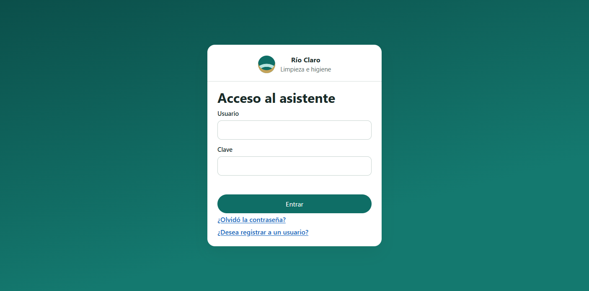

Los formularios de restablecer y de registrar **entran desde la derecha**; **Volver al acceso** los saca hacia la derecha y recupera el login desde la izquierda.

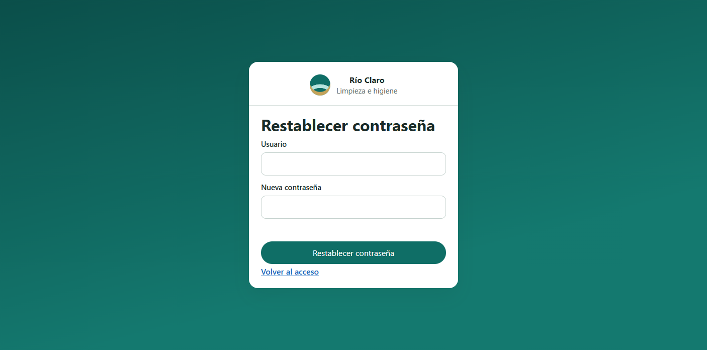

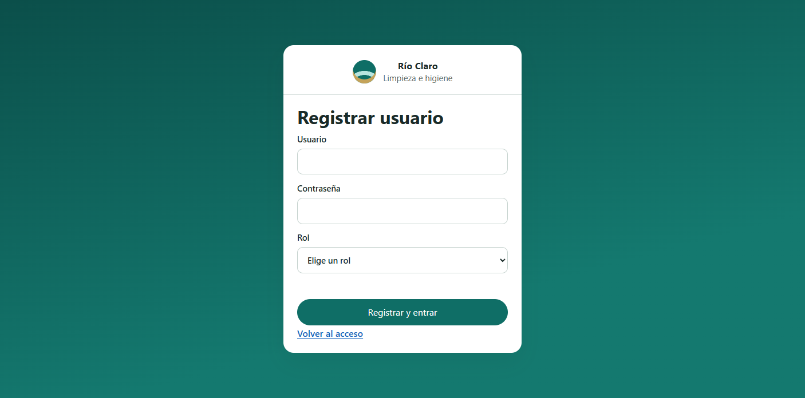

Desde los enlaces azules se abre el restablecimiento de clave o el registro con rol. La cuenta queda en `rioclaro.usuarios`; al registrar, se entra directo.

Tras un acceso correcto, un muro de esmeraldas cubre la pantalla y se rompe a trozos; después entran la barra, el historial y el chat, uno tras otro.


Tras el login, la pantalla principal muestra el panel **Tu historial** a la izquierda y el chat a la derecha.

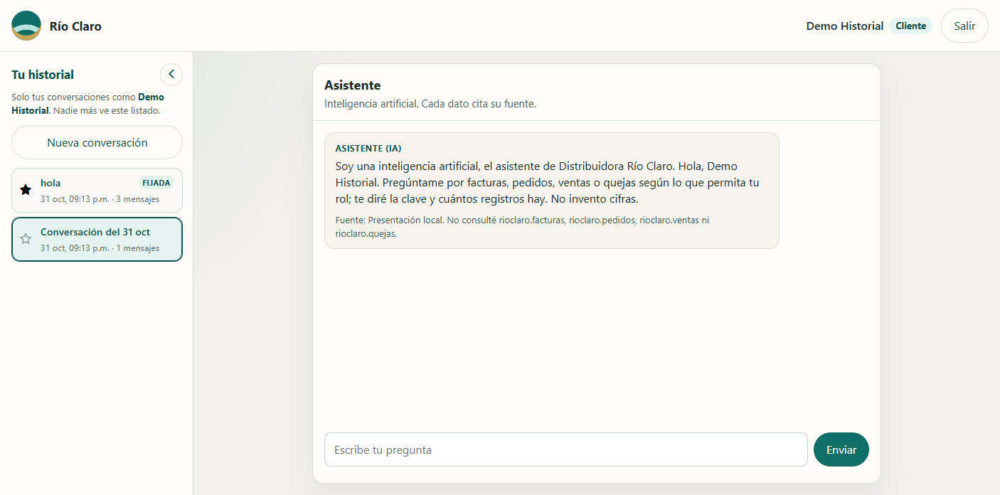

Al plegar el panel, un botón flotante con flecha a la derecha reabre el historial a la misma altura.

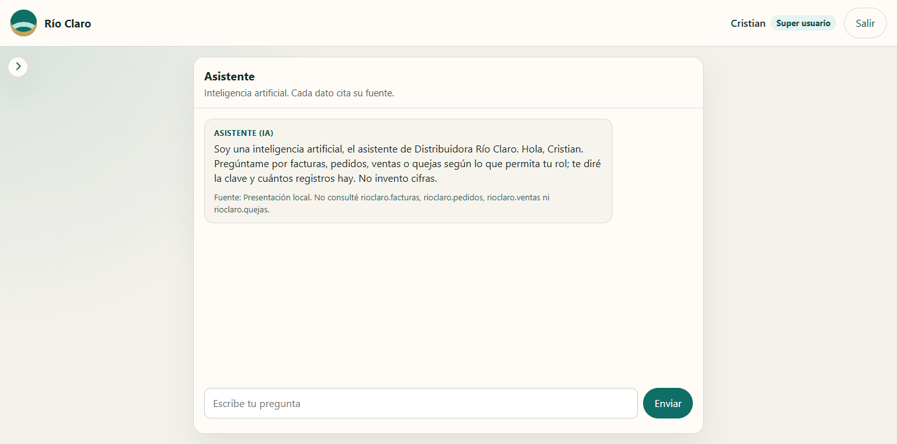

Cada conversación del listado incluye estrella (fijar), título y papelera para eliminarla.

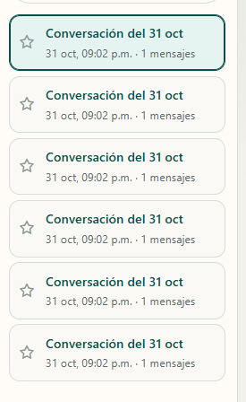

En la barra del chat, el micrófono dicta en español (México) y muestra el texto en el campo antes de enviar.

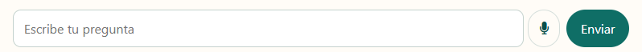

Las respuestas del asistente se muestran con saltos de línea, listas y negritas (Markdown seguro o reconstruido si el agente manda un párrafo corrido).

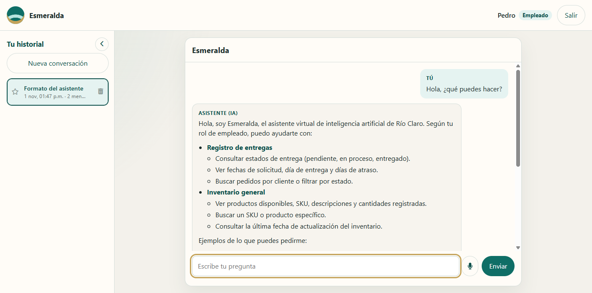

El super usuario ve un botón redondo de estadísticas abajo a la derecha; los demás roles no.

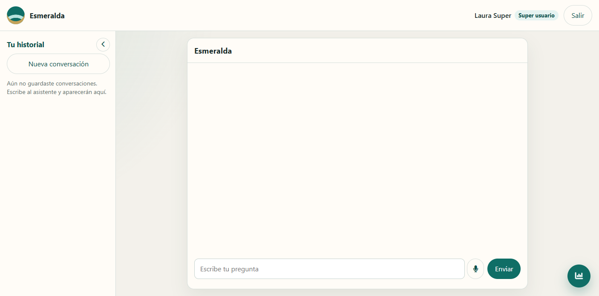

#### Estadísticas de empleados (super usuario)

**Qué hace:** deja al super usuario ver quién usa Esmeralda, cuánto tiempo, cuántos prompts manda y qué tan rápido responde el agente.

**Cómo funciona:**
1. En la pantalla principal, el super usuario pulsa el botón redondo de estadísticas (esquina inferior derecha).
2. El cliente registra sesiones, prompts y `duracionMs` en `rioclaro.estadisticas` (mismo navegador; hasta 300 sesiones). Un usuario está **conectado** si su última actividad tiene menos de 2 minutos y no pulsó Salir.
3. El panel muestra una tabla de sesiones, gráficas de barras (tiempo medio de uso y tiempo medio de respuesta por persona) y una de pastel (reparto de prompts). Arriba hay un **filtro de periodo**: atajos **Hoy**, **Últimos 7 días** y **Últimos 28 días** (rellenan el rango y actualizan las gráficas al instante). Si se elige **Desde** / **Hasta** a mano, el atajo pasa a **Personalizado** y el panel se recalcula en el acto. El tiempo de uso se recorta al intervalo elegido. El servidor no guarda estas cifras: solo informa `duracionMs` en `POST /api/asistente`.

**Quién lo usa:** `super`.

**Fuente:** `rioclaro.estadisticas`.

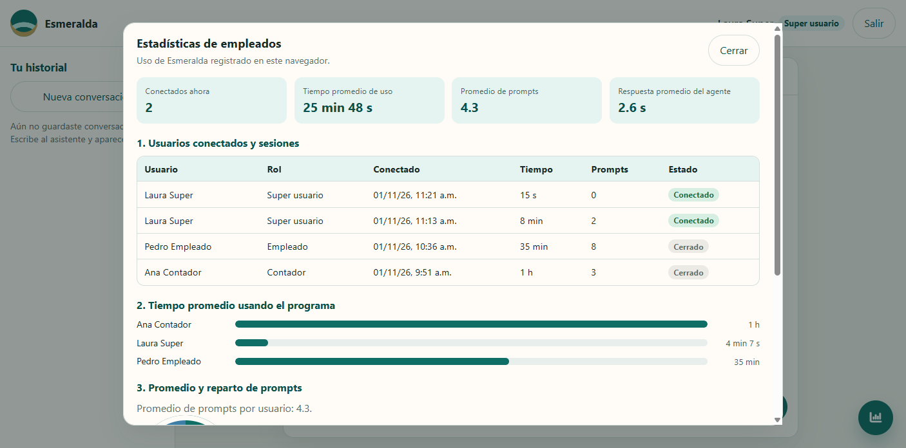

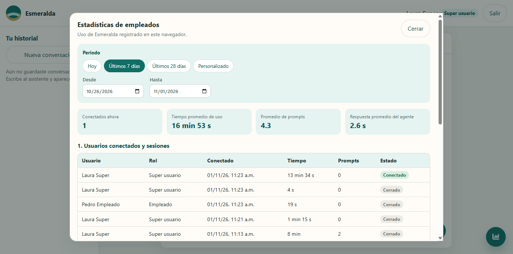

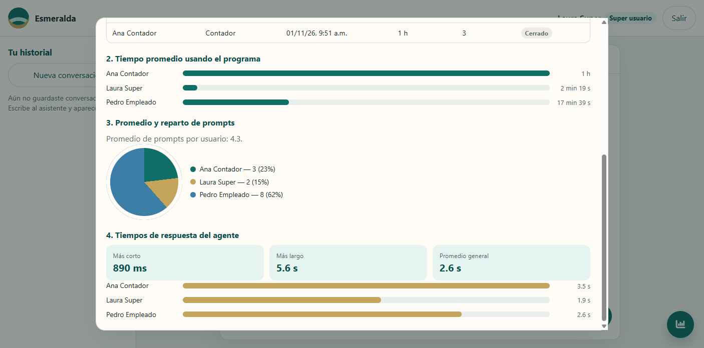

#### Facturas → Excel de proveedores

**Qué hace:** evita la captura manual de Laura.

**Cómo funciona:** el contador sube una “factura”; el sistema extrae proveedor, fecha y total y actualiza el Excel/tabla. Si el documento no tiene sentido, está duplicado o trae datos sensibles, se rechaza.

**Quién lo usa:** `contador`, `super`.

**Fuente que debe citar la IA:** Excel de proveedores / `rioclaro.facturas`.

#### Estado de pedidos

**Qué hace:** permite decirle a un cliente cuándo llega su pedido.

**Cómo funciona:** tabla `nombre_cliente` + `estado_pedido` (y fecha estimada si existe). El agente solo responde con lo que hay en esa tabla.

**Quién lo usa:** `cliente`, `empleado`, `super`.

**Fuente que debe citar la IA:** Excel de pedidos / `rioclaro.pedidos`.

#### Reportes de ventas por producto

**Qué hace:** consultas de ventas por producto.

**Cómo funciona:** el agente lee un Excel/tabla de ventas; no calcula de memoria.

**Quién lo usa:** `supervisor`, `super`.

**Fuente que debe citar la IA:** Excel de ventas / `rioclaro.ventas`.

#### Quejas

**Qué hace:** deja registro de quejas de clientes.

**Cómo funciona:** formulario → `rioclaro.quejas`.

**Quién lo usa:** `cliente`, `empleado`, `supervisor`, `super`.

## Roles

| Rol | Alcance |
|-----|---------|
| Super usuario | Todo, incluido el panel de estadísticas de uso |
| Contador | Facturas y Excel de proveedores |
| Cliente | Pedido propio, quejas, chat |
| Empleado | Pedidos, chat interno |
| Supervisor | Reportes y quejas |

## Reglas del asistente

- Afirmar que es una IA.
- Decir de qué documento o tabla salió cada dato.
- Rechazar documentos malos o sensibles; no guardarlos.

## Harness de agentes

Estructura (como en Copilot: agentes + `instructions`):

```
.github/
  copilot-instructions.md
  agents/
    arquitecto.agent.md
    constructor.agent.md
    desplegador.agent.md
  instructions/
    backend.instructions.md
    frontend.instructions.md
    documentacion.instructions.md
  skills/documentar-readme/SKILL.md
AGENTS.md
.cursor/rules/documentar-readme.mdc
.cursor/skills/documentar-readme/SKILL.md
.cursor/hooks.json
```

| Agente | Función |
|--------|---------|
| **Arquitecto** | Plan (módulos, datos, API, Foundry). No implementa. |
| **Constructor** | Código Express/UI/localStorage y README. |
| **Desplegador** | Local, Azure y Foundry, sin rediseñar el producto. |

En Copilot: elige el agente en el selector de chat (o Copilot CLI). Orden: arquitecto → constructor → desplegador.

En Cursor: las instrucciones del repo aplican igual; puedes @mencionar los `.agent.md` o seguir el mismo orden en el chat.

## Documentación automática (README)

Cada prompt que **cambia código** debe actualizar este archivo. No es un agente más: es un recordatorio en tres capas.

| Capa | Dónde | Para qué |
|------|--------|----------|
| Instrucción always-on | `.github/copilot-instructions.md`, `.github/instructions/documentacion.instructions.md`, `.cursor/rules/documentar-readme.mdc` | Que la IA reciba la orden en **cada** prompt |
| Skill | `.github/skills/documentar-readme` y `.cursor/skills/documentar-readme` | El formato (qué hace, cómo funciona, tabla, imágenes) |
| Hook Cursor | `.cursor/hooks/recordar-readme.js` al enviar el prompt; `.cursor/hooks/verificar-readme.js` al terminar | Refuerzo si hubo código y no se tocó el README |

Capturas de UI: `docs/imagenes/`. Este README es el lugar donde se explica el producto; `AGENTS.md` solo describe el harness.

### ¿Skill, agente o regla?

- Un **agente** “documentador” se olvida si no lo seleccionas.
- Una **skill sola** ayuda cuando el modelo la dispara, pero no está garantizado.
- La **instrucción / regla always-on** es lo que realmente “le recuerda” a la IA en cada prompt.
- El **hook** cubre el caso en que igual se le olvida al cerrar el turno.

Por eso el documentador no es un cuarto agente del harness: va en instrucciones + skill + hook, y el Constructor tiene el cierre obligatorio.

## Registro de cambios

| Fecha | Módulo | Resumen | Archivos clave |
|-------|--------|---------|----------------|
| 2026-11-01 | Chat | Las respuestas de la IA se pintan con formato (listas, negritas y saltos) aunque el agente mande un párrafo corrido | `public/js/app.js`, `public/css/estilos.css`, `README.md`, `docs/imagenes/chat-formato-asistente.png` |
| 2026-11-01 | Estadísticas | Filtro de periodo (Hoy, 7 días, 28 días y Personalizado) que actualiza tablas y gráficas al cambiar el rango | `public/index.html`, `public/js/app.js`, `public/css/estilos.css`, `README.md` |
| 2026-11-01 | Estadísticas | Botón fijo solo para super usuario y panel con sesiones, tiempo de uso, prompts y latencia del agente (`rioclaro.estadisticas`) | `public/index.html`, `public/js/app.js`, `public/css/estilos.css`, `index.js`, `README.md` |
| 2026-11-01 | Chat / historial | Las respuestas del asistente se quedan en el hilo que las pidió aunque abras otra conversación mientras llegan | `public/js/app.js`, `index.js`, `lib/foundry-asistente.js`, `README.md` |
| 2026-11-01 | Chat / historial | Tarjetas del historial con altura uniforme, título en una línea con elipsis, lista con scroll oculto | `public/css/estilos.css`, `public/js/app.js`, `README.md` |
| 2026-11-01 | Chat / historial | Tras el login el chat abre vacío, sin bienvenida ni hilo previo; el historial solo guarda cuando el usuario envía un mensaje | `public/js/app.js`, `README.md` |
| 2026-11-01 | Login / UI | Tras el muro de esmeraldas: barra desde arriba, historial desde la derecha y chat desde abajo | `public/js/app.js`, `public/css/estilos.css`, `README.md` |
| 2026-11-01 | Login | Tras un acceso correcto, un muro de esmeraldas cubre la pantalla y se rompe por oleadas antes del chat | `public/js/muro-esmeraldas.js`, `public/js/app.js`, `public/index.html`, `public/css/estilos.css`, `README.md` |
| 2026-11-01 | Login | Animación de entrada al recargar en la pantalla de acceso; se omite si la sesión abre directo el chat | `public/index.html`, `public/css/estilos.css`, `public/js/app.js`, `README.md` |
| 2026-10-31 | Login / historial | Tras iniciar sesión: hilo nuevo si la conversación activa no tenía mensajes del usuario; si ya había enviado, se reanuda ese hilo | `public/js/app.js`, `README.md` |
| 2026-10-31 | Chat | Dictado por voz (`es-MX`) en la barra de mensajes: botón micrófono, indicador visual al escuchar y texto en vivo en el campo | `public/index.html`, `public/js/app.js`, `public/css/estilos.css`, `README.md`, `docs/imagenes/chat-dictado-voz.png` |
| 2026-10-31 | Chat | Las respuestas nuevas de la IA se revelan progresivamente (letra a letra o por trozos según la longitud) | `public/js/app.js`, `public/css/estilos.css`, `README.md` |
| 2026-10-31 | Login | Corregido acceso tras contraseña correcta: `renderHistorial` ya no referencia `#historial-nombre` (elemento inexistente), que rompía el flujo sin mensaje en pantalla | `public/js/app.js`, `README.md` |
| 2026-10-31 | Marca / UI | Nombre del programa **Esmeralda** en login, barra, títulos y presentación del asistente (sigue siendo para Distribuidora Río Claro) | `public/index.html`, `public/js/app.js`, `index.js`, `README.md` |
| 2026-10-31 | Chat / historial | Borrado inmediato desde la papelera y toast superior derecho «El chat ha sido eliminado exitosamente» | `public/index.html`, `public/js/app.js`, `README.md` |
| 2026-10-31 | Chat / historial | Botón papelera en cada ítem del historial para eliminar conversaciones (confirmación y cambio de hilo activo) | `public/js/app.js`, `public/css/estilos.css`, `README.md`, `docs/imagenes/historial-eliminar-conversacion.png` |
| 2026-10-31 | Login / historial | Animación de entrada y vuelta entre acceso, restablecer y registrar; el panel «Tu historial» se desliza al ocultarse | `public/index.html`, `public/js/app.js`, `public/css/estilos.css`, `README.md` |
| 2026-10-31 | Chat / historial | Flechas Font Awesome para plegar el panel, estrella dentro de cada tarjeta (negra al fijar) y «Nueva conversación» sin duplicar hilos vacíos | `public/index.html`, `public/js/app.js`, `public/css/estilos.css`, `README.md` |
| 2026-10-31 | Chat / historial | Panel lateral ocultable (`panelOculto`) y fijar conversaciones (★) arriba del listado; las fijadas no se eliminan al recortar | `public/index.html`, `public/js/app.js`, `public/css/estilos.css`, `README.md` |
| 2026-10-31 | Chat / historial | Menú lateral «Tu historial» por usuario en `rioclaro.historialChat`; reabrir conversaciones y crear hilos nuevos | `public/index.html`, `public/js/app.js`, `public/css/estilos.css`, `README.md` |
| 2026-10-31 | Login / sesión | Reinicio del servidor invalida sesión y bloquea el chat hasta volver a entrar; `GET /api/estado` | `index.js`, `public/js/app.js`, `README.md` |
| 2026-10-31 | Pantalla principal | Quita el panel lateral de módulos; solo chat centrado; alta de usuarios solo desde login | `public/index.html`, `public/js/app.js`, `public/css/estilos.css`, `README.md` |
| 2026-10-31 | Login | Modal de autorización al registrar desde el login; enlace «nuevo usuario» | `public/index.html`, `public/js/app.js`, `public/css/estilos.css` |
| 2026-10-31 | Login | Registro exige contraseña de autorización antes del alta (login y módulo super) | `public/index.html`, `public/js/app.js`, `README.md` |
| 2026-10-31 | Login | Tras restablecer contraseña vuelve al acceso con toast superior derecho; etiquetas «contraseña» en login | `public/index.html`, `public/js/app.js`, `public/css/estilos.css` |
| 2026-10-31 | Login | Quita pestaña Registrar; enlaces azules para olvidé clave (por nombre) y registro; formulario de restablecimiento | `public/index.html`, `public/js/app.js`, `public/css/estilos.css` |
| 2026-10-31 | Login | Fondo verde a pantalla completa; tarjeta blanca centrada con marca y formulario de acceso | `public/index.html`, `public/css/estilos.css` |
| 2026-10-31 | Login | Pantalla de acceso centrada en viewport con tarjeta compacta (marca + formulario), sin ocupar todo el ancho | `public/index.html`, `public/css/estilos.css` |
| 2026-10-31 | Agente Foundry | Contexto `documentos-permitidos` por rol (p. ej. empleado: entregas,inventario) para alinear respuestas con la matriz de permisos | `lib/foundry-asistente.js`, `README.md` |
| 2026-10-31 | Agente Foundry | Chat con Foundry para todos los roles de la app; contexto `rol=superusuario` y `autorizacion-contable` para super; `FOUNDRY_ROLES` y plantillas `.env` actualizados | `lib/foundry-asistente.js`, `index.js`, `docs/env.example.txt`, `.env.example` |
| 2026-10-31 | Agente Foundry | Invocación del agente con `agent_reference` (API actual de Foundry; antes `agent` devolvía 400) | `lib/foundry-asistente.js` |
| 2026-10-31 | Agente Foundry | Conexión opcional a Microsoft Foundry en `/api/asistente` para rol contador; variables en `.env`; plantilla `docs/env.example.txt` | `index.js`, `lib/foundry-asistente.js`, `lib/cargar-env.js`, `docs/env.example.txt` |
| 2026-10-29 | Login y pantalla principal | Registro con rol en localStorage, sesión y pantalla con chat más el módulo del rol. El asistente responde en local por `/api/asistente` | `index.js`, `public/index.html`, `public/js/app.js`, `public/css/estilos.css` |
| 2026-10-29 | Alcance principal | El primer entregable es login, registro con rol en localStorage y pantalla principal con chat + módulo del rol | `README.md`, `.github/copilot-instructions.md`, `.github/instructions/frontend.instructions.md` |
| 2026-10-29 | Harness y documentación | Se crearon instrucciones Copilot, agentes arquitecto/constructor/desplegador, skill y hook para mantener este README | `.github/`, `.cursor/`, `AGENTS.md`, `README.md` |
